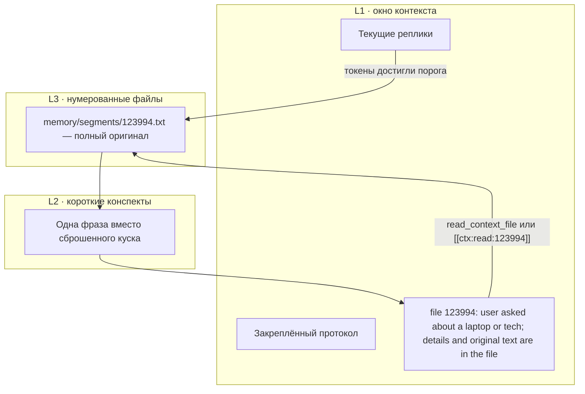

# Кортекс: мост контекста

**Context Bridge** — настольная программа для Windows. Она держит память диалога вне модели: когда окно контекста заполняется, старый текст уходит в нумерованный файл, а в окне остаётся короткий указатель. Модель не дообучается. К мосту подключается любой источник: OpenAI-совместимый API, Ollama, llama.cpp, Hugging Face или локальный режим без сети.

Автор: **ProtocolTeam (Zhandos)**.

## Авторство и приоритет

Концепция пирамидальной памяти **«Кортекс: мост контекста» (Context Bridge)** сформулирована и зафиксирована **ProtocolTeam (Zhandos), 6 ноября 2026 года**.

В этой записи уже есть само устройство:

- верх — текущий диалог в окне контекста;
- середина — короткие конспекты-указатели;
- низ — полные оригиналы в нумерованных файлах;
- при заполнении окна старый контекст заменяется строкой `file 123994: user asked about a laptop or tech; details and original text are in the file`;
- модель позже просит оригинал вызовом функции или токеном `[[ctx:read:123994]]`.

Дата приоритета: **6 ноября 2026**. Это отметка авторства, не передача прав. Условия — в [LICENSE](LICENSE).

## English

Context Bridge is a native Windows program. It keeps a pyramid of memory in front of any chat model: the live window, short pointers, and full originals in numbered files. Nothing is written into the weights.

When the window fills, older turns are replaced by a line like `file 123994: user asked about a laptop or tech; details and original text are in the file`. The model can ask for the original later.

Authorship: **ProtocolTeam (Zhandos), 6 November 2026**. All rights reserved. Viewing is allowed. Copying, modification, commercial use, and redistribution need written permission from ProtocolTeam (Zhandos). See [LICENSE](LICENSE).

The Windows executable is built by GitHub Actions (`.github/workflows/windows-exe.yml`) and attached to release `v0.1.0` and to the workflow artifacts as `context-bridge.exe`.

## Как устроена пирамида



Бюджет промпта — это размер окна минус запас под ответ. Когда оценка токенов доходит до порога (по умолчанию 0,75 бюджета), программа забирает самый старый незакреплённый кусок, записывает его целиком и ставит на его место одну строку.

Номер выдаёт архив: `1`, `2`, `3`, … `123994` в примере — форма строки, не особый идентификатор.

Если указателей становится слишком много, они сами уходят в файл-оглавление. Оригиналы не переписываются. Протокол моста закреплён и не сбрасывается. Несколько последних реплик программа старается оставить. Кнопка «Сжать» делает один сброс сразу.

Файлы лежат рядом с программой, в папке `memory`:

```text
memory/
  manifest.txt
  session.txt
  settings.txt
  segments/
    1.txt
    2.txt
```

Кнопка «Папка архива» открывает этот каталог. Двойной щелчок по файлу в списке показывает оригинал.

## Как модель читает оригинал

В запрос уходят только роль и текст. Служебные пометки в модель не попадают: она видит саму строку указателя.

Дальше два одинаковых по смыслу пути:

- инструмент `read_context_file` с номером файла и инструмент `search_context` со словами;
- токены `[[ctx:read:123994]]` и `[[ctx:search:запрос]]`, либо `<ctx-read id="123994"/>` и `<ctx-search q="запрос"/>`.

Программа выполняет чтение и зовёт модель ещё раз, уже с оригиналом. Число повторов ограничено. Полный текст не остаётся в окне навсегда: в сохранённой сессии снова указатель. Если файл больше половины бюджета, в запрос попадает начало и пометка, что хвост лежит в файле.

Короткую фразу указателя программа собирает сама, без отдельной нейросети: частые слова куска и шаблон `user asked about …`. Язык этой строки английский, чтобы протокол не менялся. Оригинал в файле хранится как был.

Поиск по архиву лексический: совпадение слов в конспекте и в теле файла. Векторного индекса нет.

## Как подключается любая модель

Один и тот же диалог каждый адаптер переводит в свой HTTP-запрос. Скрытого состояния у модели программа не хранит. Смена адаптера оставляет те же реплики и заново проверяет бюджет.

| Адаптер в окне | Куда уходит диалог |
| --- | --- |
| Локально, без сети | Никуда. Ответ собирается из текущего окна, чтобы можно было увидеть пирамиду без ключа. Это не языковая модель. |
| OpenAI-совместимый | `POST {адрес}/chat/completions`. Адрес по умолчанию `https://api.openai.com/v1`. Тот же формат у vLLM и LM Studio. |
| Ollama | `POST {адрес}/api/chat`. По умолчанию `http://127.0.0.1:11434`. |
| llama.cpp | Тот же чат, что у OpenAI. По умолчанию `http://127.0.0.1:8080/v1` (`llama-server`). |
| Hugging Face | OpenAI-совместимый роутер `https://router.huggingface.co/v1`. В поле модели — id с Hub, в поле ключа — токен. |

Имя модели, адрес и ключ задаются в окне и пишутся в `memory/settings.txt` рядом с программой. Ключ хранится на этом компьютере открытым текстом.

## Сборка

Нужны CMake и Visual Studio 2022 или новее, x64.

```bat
cmake -S . -B build -A x64
cmake --build build --config Release
```

Готовый файл: `build\Release\context-bridge.exe`. Рядом появится папка `memory`, когда программа запустится.

GitHub Actions (`.github/workflows/windows-exe.yml`) на каждый push в `main` собирает этот exe, кладёт его в артефакт `context-bridge-windows` и прикрепляет к релизу `v0.1.0`.

Проверка ядра без окна:

```bash
cmake -S . -B build
cmake --build build
./build/bridge_test
```

Тест гоняет путь «окно переполнилось → файл → указатель → повторное чтение».

## Ограничения

- Без токенизатора конкретной модели размер считается приблизительно: латиница дешевле кириллицы.
- Выжимка указателя не понимает смысл, она выбирает частые слова.
- Поиск по словам не заменяет векторный поиск.
- Программа не заставляет модель захотеть открыть файл. Она оставляет указатель и способ запроса.
- Hugging Face здесь — это HTTP роутера, не локальные веса Transformers.
- Архив рассчитан на один процесс. Две копии программы на одной папке `memory` могут помешать друг другу.

## Права

Copyright (c) 2026 ProtocolTeam (Zhandos). All rights reserved.

Просмотр разрешён. Копирование, изменение, коммерческое использование и распространение без письменного разрешения ProtocolTeam (Zhandos) запрещены. Текст — в [LICENSE](LICENSE).

Подробное устройство — в [docs/ARCHITECTURE.md](docs/ARCHITECTURE.md).
